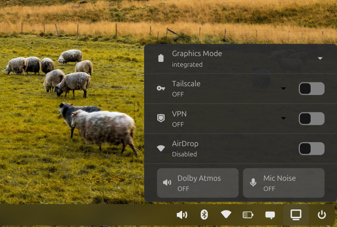

# cosmic-command-center-nv
An (Unofficial) Cosmic Desktop Command Center Applet (Rust) - For Nvidia Devices on Devices with Nvidia Graphics Cards.

### Why?
Cosmic Desktop is awesome especially the new Cosmic Epoch that now uses Rust inside! As it's quite in its early days of development, I couldn't find a GUI toggle to switch my Graphics modes easily (There is an easy cli command that does this for you though, but I thought I'd give this a shot)

Tailscale VPN support for Direct connections and 3 exit nodes (currently configured manually)

VPN support via Cosmic Settings configured VPNs, this toggles them on/off.

EasyEffects output and input effects.

### How?
This simply fires the already built and stable `system76-power graphics` command and presents the options to you.
The following options are what suited me best:
- `integrated`
- `compute`
- `hybrid`
- `nvidia`

### Who?
I'm a total newbie to Rust, would like this to be a first step (so this definitely includes AI) and hence has no intention to merge this to become a real applet unless a proper developer takes a look at this and makes it more efficient.

#### DISCLAIMER
This project includes an SVG that denotes the **NVIDIA** logo and hence all rights to the logo belongs **NVIDIA**. Also mentions about **Cosmic** which is part of **System76**'s awesome software offerings. Tailscale too are titles referring to their own services. This is purely developed in good faith. 
